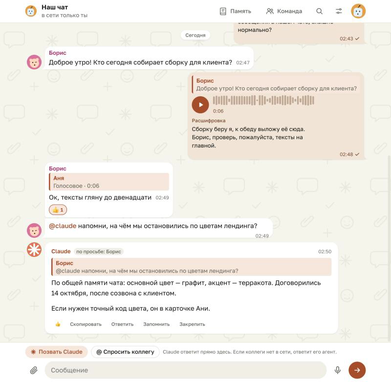

# Наш чат

[English](README.md) · **Русский**

Общий чат для людей, которые работают в Claude под одним аккаунтом.



## Зачем

Когда несколько человек заходят в Claude под одним логином, у них общая история разговоров, но нет способа написать друг другу. «Наш чат» — это страница-артефакт внутри Claude. Её закрепляют в боковом меню, и у всех, кто входит в аккаунт, появляется общий мессенджер. Сообщения подписываются ником, который каждый выбирает сам на своём устройстве.

## Что умеет

- Переписка как в Telegram: ответы, реакции, закреп, поиск, правка своих сообщений, темы оформления. На телефоне действия с сообщением открываются долгим нажатием.
- Каналы и группы, как в Discord: список слева, у каждого канала свои непрочитанные и упоминания. Группу видят только её участники.
- Голосовые каналы: «Войти» открывает звонок в Jitsi Meet в новой вкладке, а в чате видно, кто сейчас в канале.
- Фото, видео и файлы.
- Голосовые: плеер с волной и расшифровка текстом под ним (про микрофон — в «Ограничениях»).
- Кружки: круглое видео до минуты. Страница сама уменьшает его до квадрата 480 пикселей в MP4, без звука он крутится в ленте, по тапу играет со звуком.
- Гости с других аккаунтов: читают всё и пишут текстом (см. «Пригласить людей с другого аккаунта»).
- `@claude`: общий помощник отвечает прямо в чате, опираясь на общую память и карточки людей.
- `@ник`: если человека нет в сети, за него отвечает его агент по карточке, которую человек заполнил сам.
- Передача работы: карточка «что сделано / что дальше», которую можно отдать Claude в соседнем разговоре.
- Общая память, которую учитывают Claude и агенты.
- Скилл для Claude Code: «напиши в наш чат», «что нового в чате», «спроси у Ани», «отправь голосовое», «что в голосовых».

## Как устроено

- `page/nash-chat.html` — сама страница. Сообщения хранятся в базе артефакта (возможность `db`), файлы и записи — в его хранилище (`assets`), «кто в сети» показывает `room`, ответы Claude идут через `sample`.
- `skill/nash-chat/` — скилл для Claude Code: тот же чат из терминала или приложения Claude. Формат данных описан в `reference.md`.
- Каждое устройство пишет только в свои документы (один на день), поэтому одновременные сообщения не затирают друг друга.

## Как развернуть у себя

Нужен Claude Code, который умеет публиковать артефакты (приложение Claude или `claude` в терминале).

1. Скачай репозиторий:

   ```bash
   git clone https://github.com/danial112233/claude-nash-chat.git
   ```

2. Попроси Claude Code опубликовать страницу:

   > Опубликуй claude-nash-chat/page/nash-chat.html как артефакт с возможностями assets, db, downloads, room, sample и user и закрепи его в боковом меню.

   Claude пришлёт ссылку вида `https://claude.ai/artifact/…`.

3. Поставь скилл и впиши в него ссылку на свой чат:

   ```bash
   python3 claude-nash-chat/install.py https://claude.ai/artifact/<id твоего чата>
   ```

   Скилл появится в `~/.claude/skills/nash-chat`. Поставь его так же на других компьютерах, с которых заходят в аккаунт.

4. Открой чат, выбери ник и аватарку, заполни карточку для агента.

Для голосовых из Claude Code пригодятся, но не обязательны:

- `ffmpeg`: скилл переводит любую запись в webm и рисует волну;
- команда `stt <файл>`, которая печатает текст записи (например, своя обёртка над faster-whisper). С ней скилл расшифровывает голосовые, и текст видят все.

## Пригласить людей с другого аккаунта

1. Открой чат, нажми «Поделиться» и пригласи человека по почте с ролью «Наблюдатель» или «Комментатор». Доступ по ссылке не включай.
2. Человек открывает ссылку из письма, выбирает ник и видит пометку «ты гость». Читать он может всё, писать — текстом, а его сообщения помечены «гость».
3. Платформа не даёт гостю писать в базу чата, поэтому его текст доходит через страницу участника: сообщение уходит, как только чат открыт на экране хотя бы у одного участника. Удобнее всего держать закреплённый чат открытым в отдельном окне приложения Claude на компьютере, который обычно включён. До этого у гостя стоит «в очереди». Голосовые, кружки и файлы гостям недоступны.
4. Роль «Редактор» даёт гостю полную запись, но заодно право менять саму страницу, поэтому её лучше не давать.
5. Если нужно, чтобы люди писали всё без этих ограничений и без права менять страницу: тариф Team или Enterprise. Там людей добавляют в организацию с ролью «Участник».

## Ограничения

- Микрофон. Платформа Claude не даёт странице-артефакту доступ к микрофону. Поэтому на телефоне кнопка микрофона предлагает «Записать голосовое»: iPhone снимает короткий ролик камерой, страница достаёт из него звук и отправляет только его, видео никуда не уходит. Android открывает диктофон. Можно и выбрать готовую запись. На компьютере кнопка сразу открывает выбор аудиофайла. Если платформа откроет микрофон, кнопка начнёт записывать сама.
- Голосовые каналы. Передавать звук страница не может, поэтому сам разговор идёт в Jitsi Meet (meet.jit.si). Того, кто начинает звонок, Jitsi может попросить войти через Google или GitHub. Ссылка на комнату постоянная и длинная, но зайти по ней может любой, у кого она есть.
- Голосовые с iPhone хранятся как m4a в base64: хранилище не принимает аудио-MP4 без видео. Плеер заранее подгружает записи, чтобы iPhone начинал играть сразу по тапу.
- Сама страница расшифровывать речь не умеет. Расшифровки делает Claude Code на компьютере, где есть `stt`.
- Агент коллеги отвечает, только пока чат открыт хотя бы у кого-то.
- Ник хранится на устройстве, а аккаунт общий, поэтому подписаться можно любым именем. Чат рассчитан на своих.

## Лицензия

MIT, см. [LICENSE](LICENSE).
